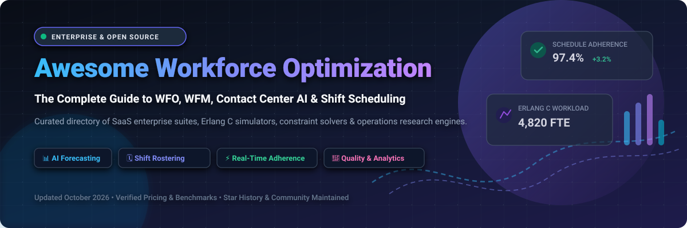

# 🚀 Awesome Workforce Optimization (WFO) Ecosystem

<p align="center">
  
</p>

<p align="center">
  <a href="https://github.com/ishandutta2007/Awesome-Awesome-Awesome"></a><a href="https://discord.gg/jc4xtF58Ve"></a>
  <a href="https://github.com/ishandutta2007/Awesome-Workforce-Optimization-WFO/stargazers"></a>
  <a href="https://github.com/ishandutta2007/Awesome-Workforce-Optimization-WFO/network/members"></a>
  <a href="https://github.com/ishandutta2007/Awesome-Workforce-Optimization-WFO/issues"></a>
  <a href="LICENSE"></a>
  <a href="https://github.com/ishandutta2007"></a>
</p>

---

> **A curated directory of top Workforce Optimization (WFO), Workforce Engagement Management (WEM), and Workforce Management (WFM) SaaS platforms alongside open-source constraint solvers, Erlang C call-center simulators, and shift-scheduling algorithms.**

*Focused on Contact Center Scheduling, Intraday Adherence, AI Demand Forecasting, Quality Management (QM), and Operations Research Optimization.*

---

## 📑 Table of Contents

- [🌐 Sector Overview & Market Dynamics](#-sector-overview--market-dynamics)
- [🏢 SaaS & Hosted Enterprise WFO Platforms](#-saas--hosted-enterprise-wfo-platforms)
- [💻 Open-Source GitHub Projects (Ranked by Stars)](#-open-source-github-projects-ranked-by-stars)
- [🔬 Operations Research & Architecture Framework](#-operations-research--architecture-framework)
- [🔍 SEO & Industry Keywords](#-seo--industry-keywords)
- [🤝 How to Contribute](#-how-to-contribute)
- [⚠️ Compliance & Disclaimer](#-compliance--disclaimer)
- [📈 Star History](#-star-history)
- [💖 Support & Community](#-support--community)

---

## 🌐 Sector Overview & Market Dynamics

The global **Workforce Optimization (WFO)** and **Workforce Management (WFM)** market is valued at approximately **$10.8 Billion to $12.5 Billion in 2025–2026** and is projected to exceed **$20.5 Billion by 2030**, expanding at a Compound Annual Growth Rate (**CAGR of ~11.2%**), propelled by generative AI call summaries, automated agent coaching, and multi-skill intraday forecasting.

The market structure is **moderately concentrated at the top tier**, where a handful of large-cap CCaaS and enterprise service cloud vendors (*ServiceNow, Genesys, NICE, Five9, and Verint*) control the majority of multi-thousand-seat contact center deployments; however, the sector experiences **strong fragmentation at the mid-market and developer layers**, where agile SaaS contenders and self-hosted open-source constraint solvers provide transparent, code-first alternatives free from multi-year per-seat lock-in.

---

## 🏢 SaaS & Hosted Enterprise WFO Platforms

*The following table catalogs category-defining commercial WFO/WEM platforms. The table is sorted descending by company size (valuation / market capitalization).*

| 🏢 Platform / Vendor | 💰 Company Valuation / Revenue | 🏷️ Specific Starting Pricing | 🎁 Specific Free Tier / Trial Limits | ⚡ Core WFO / WEM Capabilities |
| :--- | :--- | :--- | :--- | :--- |
| **[ServiceNow Workforce Optimization](https://www.servicenow.com/)** | **~$190 Billion Market Cap** (NYSE: `NOW`; ~$10.0B ARR) | **$160 / user / month** (Fulfiller seat bundled within ITSM Enterprise or CSM Enterprise tier) | **Indefinite Free Personal Developer Instance (PDI)** with full admin features (active indefinitely if accessed every 10 days) or 15-day guided enterprise sandbox | Omnichannel workload routing, AI agent capacity scheduling, manager operational dashboards, performance and skills-based coaching modules. |
| **[Genesys Cloud CX](https://www.genesys.com/)** | **~$21 Billion Valuation** (~$3.0B total revenue; $1.5B+ Cloud ARR) | **$75 / user / month** (CX 1 voice); **$155 / user / month** (CX 3 with full Workforce Engagement Management) | **30-Day Free Trial** (GCXNow / Activate program) with up to 5 user seats, pre-configured call queues, and digital channel routing | Cloud-native omnichannel forecasting, machine learning shift trading, intraday adherence monitoring, agent gamification. |
| **[Talkdesk Workforce Management](https://www.talkdesk.com/)** | **~$10 Billion Valuation** (Series D; ~$350M ARR) | **$85 / user / month** (CX Cloud Digital Essentials); **$165 / user / month** (Elite edition with native WFM) | **15-Day Free Trial** (Talkdesk Express package) with up to 25 test agent licenses and preloaded telecom sandbox credits | Multi-queue forecast editing, CSV schedule bulk uploads, intraday queue tagging, and team-scoped scheduling governance. |
| **[NICE CXone](https://www.nice.com/)** | **~$7.1 Billion Market Cap** (NASDAQ: `NICE`; ~$2.4B Revenue) | **$110 / agent / month** (Omnichannel Suite); **$169 / agent / month** (Core Suite with full WFM module) | **30-Day Guided Proof-of-Concept (POC)** sandbox environment with sample contact center datasets upon sales qualification | AI-powered historical forecasting, machine learning rostering, real-time intraday adherence management, agent mobile app. |
| **[Five9 WEM](https://www.five9.com/)** | **~$2.8 Billion Market Cap** (NASDAQ: `FIVN`; ~$910M Revenue) | **$119 / user / month** (Digital/Core); **$179 to $229 / user / month** (Optimum & Ultimate WEM bundles) | **30-Day Sales-Assisted Sandbox Trial** with up to 10 test agent seats and simulated telephony queues (no self-serve free tier) | Interaction recording, shift schedule bidding, real-time adherence reporting, long-term operational capacity planning. |
| **[Verint Workforce Optimization](https://www.verint.com/)** | **~$1.25 Billion Market Cap** (NASDAQ: `VRNT`; ~$910M Revenue) | **$40 / user / month** (Standalone WFM module); **$85 / user / month** (Integrated WFO suite) | **30-Day Proof-of-Value (POV) Sandbox** with preconfigured queue metrics and agent profiles upon enterprise sales consultation | TimeFlex Bot for autonomous employee schedule flexibility, omni-channel demand forecasting, multi-skill scheduling. |
| **[Calabrio ONE](https://www.calabrio.com/)** | **~$1.0B–$2.0B Valuation** (Thoma Bravo portfolio, integrated under Verint; ~$150M ARR) | **$45 / agent / month** (Standalone WFM module); **$90 to $120 / agent / month** (Calabrio ONE full suite) | **30-Day Customized Pilot Sandbox** with sample contact center recordings, evaluation forms, and shift templates | AI Auto Coaching, automated intraday re-forecasting, QM speech analytics, desktop and screen activity recording. |
| **[Alvaria Workforce](https://www.alvaria.com/)** | **~$1.0 Billion Valuation** (Abry Partners; merger of Aspect & Noble Systems; ~$350M Revenue) | **$45 / agent / month** (Workforce module); **$90 / agent / month** (Enterprise contact center suite) | **30-Day Guided Virtual Lab POC** for up to 10 agent profiles upon enterprise solution scoping | Real Time Optimizer, automated idle-time micro-training delivery, dynamic intraday staffing adjustments, multi-site scheduling. |
| **[Assembled WFM](https://www.assembled.com/)** | **~$350 Million Valuation** (Series B funded; ~$25M ARR) | **$15 / agent / month** (Lite); **$35 / agent / month** (Pro tier with AI forecasting & multi-channel scheduling) | **14-Day Full-Access Free Trial** with unlimited seats, full API access, and native integrations for Zendesk, Salesforce, and Intercom | Modern API-first WFM, bidirectional ticketing sync, real-time intraday heatmaps, and automated staffing deficiency alerts. |
| **[Playvox WFM](https://www.playvox.com/)** | **~$100 Million+ Valuation** (Acquired by NICE; ~$25M Revenue) | **$15 / user / month** (Quality); **$35 / user / month** (WFM module with automated shift planner) | **14-Day Free Trial** with up to 15 agent seats and standard CRM/helpdesk integrations (Zendesk, Salesforce, Kustomer) | Employee engagement gamification, drag-and-drop shift planner, real-time adherence visibility, agent recognition boards. |
| **[injixo](https://www.injixo.com/)** | **~$20 Million Market Cap** (Frankfurt: InVision AG / Peopleware; ~$15M Revenue) | **€9 (~$10) / user / month** + €299 / month base fee (Essential tier; covers first 20 agents) | **30-Day Full-Feature Free Trial** with up to 25 user accounts, unlimited forecasting, and shift optimization routines | AI/ML Erlang-compatible forecasting, automatic break and shift optimization, absence management, employee self-service portal. |

---

## 💻 Open-Source GitHub Projects (Ranked by Stars)

*For operations researchers, developers, and engineering teams seeking transparent algorithms, customizable constraint solvers, and self-hosted scheduling pipelines without per-seat licensing lock-in. Sorted descending by GitHub stargazers count.*

1. **[TimefoldAI/timefold-solver](https://github.com/TimefoldAI/timefold-solver)** [](https://github.com/TimefoldAI/timefold-solver/stargazers)  
   *Technology: Java / Kotlin*  
   The leading open-source constraint satisfaction AI solver. Formulates and solves complex workforce scheduling, employee rostering, shift pattern matching, skill-based task assignments, labor union constraints, and hospital nurse rotations with mathematical optimality.

2. **[Staffjoy/v2](https://github.com/Staffjoy/v2)** [](https://github.com/Staffjoy/v2/stargazers)  
   *Technology: Go / Python / React*  
   Complete, production-tested open-source workforce management suite originally built for shift-based businesses. Provides microservices for shift scheduling, employee time tracking, mobile notifications, availability collection, and manager dashboards.

3. **[TimefoldAI/timefold-quickstarts](https://github.com/TimefoldAI/timefold-quickstarts)** [](https://github.com/TimefoldAI/timefold-quickstarts/stargazers)  
   *Technology: Java / Quarkus / Spring Boot / Python*  
   Comprehensive repository of prebuilt reference architectures, including complete quickstarts for employee rostering, 24/7 call center shift scheduling, hospital shift allocation, and task dispatching.

4. **[optapy/optapy](https://github.com/optapy/optapy)** [](https://github.com/optapy/optapy/stargazers)  
   *Technology: Python*  
   AI constraint solver for Python enabling operations research planners and data scientists to solve employee rostering, shift assignment, and capacity planning problems natively in Python without Java boilerplate.

5. **[rodrigo-arenas/pyworkforce](https://github.com/rodrigo-arenas/pyworkforce)** [](https://github.com/rodrigo-arenas/pyworkforce/stargazers)  
   *Technology: Python*  
   Standard Python library purpose-built for workforce management. Features queuing theory implementations (Erlang C with shrinkage and patience factors), multi-skill shift scheduling via Mixed Integer Linear Programming (PuLP), and roster optimization routines.

6. **[SirChri/employee-shift-scheduler](https://github.com/SirChri/employee-shift-scheduler)** [](https://github.com/SirChri/employee-shift-scheduler/stargazers)  
   *Technology: React / Java Spring Boot / PostgreSQL*  
   Full-stack web application designed for small and medium operations to manage employee shift rosters, time-off requests, and weekly schedule distribution through a responsive calendar interface.

7. **[lbiedma/shift-scheduling](https://github.com/lbiedma/shift-scheduling)** [](https://github.com/lbiedma/shift-scheduling/stargazers)  
   *Technology: Python / PuLP / COIN-OR*  
   Operations research codebase applying Mixed Integer Programming (MIP) to solve workforce shift scheduling problems, balancing agent availability, break windows, and fluctuating hourly demand curves.

8. **[dwave-examples/nurse-scheduling](https://github.com/dwave-examples/nurse-scheduling)** [](https://github.com/dwave-examples/nurse-scheduling/stargazers)  
   *Technology: Python / D-Wave Ocean SDK*  
   Quantum annealing and hybrid classical-quantum solver formulations for nurse and employee rostering under complex hard and soft labor constraints.

9. **[A-Herzog/Callcenter-Simulator](https://github.com/A-Herzog/Callcenter-Simulator)** [](https://github.com/A-Herzog/Callcenter-Simulator/stargazers)  
   *Technology: Java*  
   Platform-independent, event-oriented stochastic simulation software designed to calculate realistic contact center staffing requirements, wait times, and queue abandonment rates beyond standard Erlang C assumptions.

10. **[j3soon/nurse-scheduling](https://github.com/j3soon/nurse-scheduling)** [](https://github.com/j3soon/nurse-scheduling/stargazers)  
    *Technology: Python / TypeScript / React*  
    Hospital-proven open-source web application for automated nurse and staff schedule optimization, featuring flexible real-world labor constraints and an experimental AI scheduling assistant.

11. **[A-Herzog/Mini-Callcenter-Simulator](https://github.com/A-Herzog/Mini-Callcenter-Simulator)** [](https://github.com/A-Herzog/Mini-Callcenter-Simulator/stargazers)  
    *Technology: Java*  
    Lightweight simulation engine for rapid modeling of call center queue dynamics, retrial behaviors, and varying arrival distribution patterns.

12. **[beingzy/erlang_c](https://github.com/beingzy/erlang_c)** [](https://github.com/beingzy/erlang_c/stargazers)  
    *Technology: Python*  
    Call center staffing calculation toolkit implementing classic Erlang C formulas alongside discrete-event simulation routines to benchmark required FTE agent numbers against SLA targets.

---

## 🔬 Operations Research & Architecture Framework

When building a self-hosted or hybrid **Workforce Optimization pipeline**, organizations typically structure their architecture into three algorithmic stages:

```
[1. Demand Forecasting]           [2. Capacity & Erlang C]          [3. Shift Rostering & MIP]
  Historical Contact Volume   ==>   Required FTE Headcount   ==>      Constraint Optimization
  (Time-Series / ML Models)         (pyworkforce / Erlang C)          (Timefold / PuLP / OptaPy)
            ||                                ||                                  ||
            \/                                \/                                  \/
  Hourly Inbound Calls & Chats      SLA, Occupancy & Shrinkage        Assigned Shifts & Breaks
```

1. **Demand Forecasting**: Predict contact arrival volume (calls, chats, emails, tickets) across 15-minute or 30-minute intervals using seasonal ARIMA, Prophet, or LSTM models.
2. **Staffing Requirements Calculation**: Feed contact volume, Average Handling Time (AHT), and target Service Level (e.g., 80% answered in 20 seconds) into **Erlang C** equations with shrinkage factors to compute required Full-Time Equivalents (FTE).
3. **Shift Scheduling & Constraint Optimization**: Formulate a Mixed Integer Linear Program (MILP) or constraint model in **Timefold** or **pyworkforce** to assign shifts, break windows, and days off while honoring employee availability, labor laws, and skill tags.
4. **Intraday Adherence & Simulation**: Continuously simulate operational variance using **Callcenter Simulator** to adjust intraday schedules when unexpected volume spikes occur.

---

## 🔍 SEO & Industry Keywords

`Workforce Optimization (WFO)` • `Workforce Engagement Management (WEM)` • `Workforce Management (WFM)` • `Contact Center as a Service (CCaaS)` • `Erlang C Calculator` • `Call Center Staffing Simulator` • `Employee Shift Scheduling` • `Nurse Rostering Problem (NRP)` • `Mixed Integer Linear Programming (MILP)` • `Intraday Adherence Monitoring` • `Omnichannel Contact Center Forecasting` • `Agent Coaching and Quality Management (QM)` • `Timefold Solver Rostering` • `Open Source Shift Scheduler`

---

## 🤝 How to Contribute

We actively welcome contributions from the workforce management and operations research community!

1. 🍴 **Fork the repository** on GitHub.
2. 🌿 **Create a feature branch**: `git checkout -b feature/add-new-wfo-tool`.
3. 📝 **Add or update entries**: Follow the existing tabular structure for SaaS (including specific pricing, free trial limits, and valuation) or open-source projects (including repo badge and stargazers link).
4. ✅ **Ensure accuracy**: Verify that pricing and free trial terms are verified against official documentation or vendor rate sheets.
5. 🚀 **Submit a Pull Request**: Provide a succinct summary of the addition and relevant links.

Explore more curated developer lists at **[Awesome-Awesome-Awesome](https://github.com/ishandutta2007/Awesome-Awesome-Awesome)**.

---

## ⚠️ Compliance & Disclaimer

- **Community Curated**: This repository is a community-driven informational resource; listings do not constitute commercial endorsement.
- **Regulatory Compliance**: WFO platforms monitoring employee communications, screen recordings, biometric telemetry, or schedule changes must adhere to relevant labor laws, union collective bargaining agreements, and privacy frameworks (**GDPR**, **CCPA/CPRA**, **HIPAA**, and **BIPA**).
- **Open-Source Scope**: Self-hosted scheduling algorithms and simulation engines require dedicated engineering effort to integrate with real-time CCaaS telephony streams and CRM feeds.
- **Licensing**: Verify the respective open-source licenses (Apache 2.0, MIT, GPL) before embedding constraint solvers in proprietary products.

---

## 📈 Star History

[](https://star-history.dera.page/#ishandutta2007/Awesome-Workforce-Optimization-WFO&type=date&legend=top-left)

---

## 💖 Support & Community

Thank you for exploring and utilizing the **Awesome Workforce Optimization (WFO)** repository! Maintaining this comprehensive ecosystem guide requires ongoing market research, benchmark verifications, and tool curation.

If this repository saved you time, informed your architecture, or helped your contact center operations:
- ⭐ **Star this repository** to help others discover it!
- 🍴 **Fork it** to create custom internal benchmarks or add your team's tools.
- 📢 **Share it** on LinkedIn, X/Twitter, or Reddit with fellow operations researchers and WFM professionals.
- ☕ **Buy a coffee & sponsor**: Support continuous maintenance via the [GitHub Sponsors Dashboard](https://github.com/sponsors/ishandutta2007).
